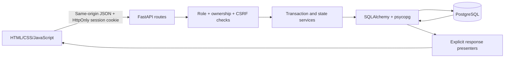

# Architecture and review guide

The frontend contains presentation state, not order/payment authority. Refresh
and navigation reload records through the API. Fifteen-second polling updates
relevant views when forms are not being edited or a password revealed. The
application serves its own CSS, JavaScript and Public Sans files under `/assets`;
there are no build tools or external frontend services required at runtime.

## Order request flow

1. `GET /api/plans` reads enabled plans. The frontend renders the three tariff
   columns. A selected plan and monthly/annual radio controls form the checkout.
2. `POST /api/orders` accepts only plan ID and term. FastAPI validates input,
   loads the current customer session and CSRF token, then locks the plan.
   The backend copies resource and price values into an order and creates its
   invoice. The customer cannot send their own price or customer ID.
3. `POST /api/invoices/{id}/payments` checks invoice ownership and locks the
   order/invoice and creates a Monobank acquiring invoice for the same euro
   amount (`ccy` 978, no conversion). The browser is redirected to its `pageUrl`;
   afterwards Monobank returns the customer to `#invoice/{id}`. The payment
   status comes only from Monobank: a signed webhook (ECDSA, `X-Sign`) when
   `PUBLIC_URL` is https, plus polling of `invoice/status` by the background
   worker and the invoice page. Success marks the invoice paid and the order
   awaiting_allocation atomically. All Monobank HTTP calls live in
   `app/billing/monobank.py`; payment state transitions live in
   `app/billing/service.py` and the endpoints in `app/billing/routes.py`.
4. `GET /api/operator/queue` requires an operator. Allocation locks order then
   server, validates exact resource matching and availability, and inserts a
   rental. A partial unique index prevents more than one held rental per server.
5. `GET /api/rentals` returns the customer's assigned rentals. The detail panel
   displays IP/user/term/expiry. Only `POST /api/rentals/{id}/reveal-password`
   returns a decrypted password; general list/detail responses never do.

Every request uses a database transaction, committed on success and rolled back
on errors. SELECT FOR UPDATE guards state transitions; locked rows are refreshed
from PostgreSQL after lock acquisition to avoid stale ORM data during concurrent
requests. Business conflicts return HTTP 409, ownership misses return 404,
unauthenticated access returns 401 and forbidden staff actions return 403.

## Roles

| Resource/action | Customer | Operator | Support | Manager |
| --- | --- | --- | --- | --- |
| Public active catalogue | Read | Read | Read | Read |
| Orders/invoices/payments/saved cards | Own | Allocation queue only | No | No |
| Rental access/password/renewal/auto-renewal | Own | Operational inventory only | Ticket context without password | No |
| Allocation, operation resolution, suspension/preparation | No | Yes | No | No |
| Request server operations | Own active rental | No | No | No |
| Support conversations | Own | No | Yes | No |
| Ticket statuses | No | No | Yes | No |
| Create/update/disable plans | No | No | No | Yes |
| Activity | No | Operational actions | Ticket actions | No |

User roles come from the database, never a request field or frontend menu.
Passwords used for sign-in are Argon2 hashes; VPS passwords use authenticated
Fernet encryption with an environment key. HttpOnly session tokens are hashed
before storage, expire after 24 hours, and are removed on logout. A separate
session-bound CSRF token is required for authenticated writes. Origin checks
also cover unauthenticated login/registration. API responses use `no-store`.

## Review questions each member should answer

- Why retain order snapshots instead of reading the latest plan at invoice time?
- Which locks and unique indexes prevent duplicate payment/assignment?
- When exactly does the initial rental start, and how does renewal extend it?
- Why can an expired or suspended server not immediately be reassigned?
- Why does the power button wait for an operator instead of changing locally?
- Which endpoints enforce role and customer ownership restrictions?
- How are server credentials stored and why do general responses omit them?
- What persists when the browser or FastAPI process restarts?

## Technical references

- [FastAPI response cookies](https://fastapi.tiangolo.com/advanced/response-cookies/)
- [SQLAlchemy constraints and indexes](https://docs.sqlalchemy.org/en/20/core/constraints.html)
- [SQLAlchemy row locking](https://docs.sqlalchemy.org/en/20/core/selectable.html#sqlalchemy.sql.expression.GenerativeSelect.with_for_update)
- [Official PostgreSQL Windows binaries information](https://www.postgresql.org/download/windows/)
