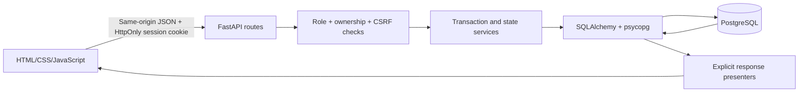

# Architecture and review guide

The frontend contains presentation state, not order/payment authority. Refresh
and navigation reload records through the API. Fifteen-second polling updates
relevant views when forms are not being edited or a password revealed. The
application serves its own CSS, JavaScript and Public Sans files under `/assets`;
there are no build tools or external frontend services required at runtime.

## Lists and pagination

Tickets, history, the allocation queue, the server pool and operation requests
are paged with keyset cursors (`app/pagination.py`): a response is
`{"items": [...], "next_cursor": ...}` and the next page continues after the
last row's `(sort key, id)` instead of skipping rows with `OFFSET`. It stays
fast deep into a list and never repeats or skips rows while new ones arrive.
Pages hold 50 rows; the frontend's "Show more" appends the next one, and
polling refreshes the visible list in batches of at most 200 rows. Filters
run in the API and each list is built with joins in a constant number of
queries (`tests/test_pagination.py` counts them). Menu and filter badges come
from `GET /api/counts`, and the ticket and server pages load their own record.

## Order request flow

1. `GET /api/plans` reads enabled plans. The frontend renders the three tariff
   columns. A selected plan and monthly/annual radio controls form the checkout.
2. `POST /api/orders` accepts only plan ID and term. FastAPI validates input,
   loads the current customer session and CSRF token, then locks the plan.
   The backend copies resource and price values into an order and creates its
   invoice. The customer cannot send their own price or customer ID.
3. `POST /api/invoices/{id}/payments` checks invoice ownership and locks the
   order/invoice. It saves a UAH charge quote and opens a Monobank test payment
   page. Authenticated bank status or a signed callback fulfills the invoice
   atomically; success queues allocation. Each attempt has an idempotency key.
4. `GET /api/operator/queue` requires an operator. Allocation locks order then
   server, validates exact resource matching and availability, and inserts a
   rental. A partial unique index prevents more than one held rental per server.
5. `GET /api/rentals` returns the customer's assigned rentals. The detail panel
   displays IP/user/term/expiry. Only `POST /api/rentals/{id}/reveal-password`
   returns a decrypted password; general list/detail responses never do.

Every request uses a database transaction, committed on success and rolled back
on errors. SELECT FOR UPDATE guards state transitions; locked rows are refreshed
from PostgreSQL after lock acquisition to avoid stale ORM data during concurrent
requests. Business conflicts return HTTP 409, ownership misses return 404,
unauthenticated access returns 401 and forbidden staff actions return 403.

## Monobank test checkout

`app/billing/` contains the gateway, validated schemas, routes, response views
and payment state services. Hosted payments use
`POST /api/invoices/{id}/payments`; manual renewal first creates/reuses an
invoice through `POST /api/rentals/{id}/renewal-invoice`.

The gateway verifies the sandbox merchant, quotes EUR prices in UAH using the
public sell rate and saves exact minor units before requesting checkout.
Authenticated status responses and ECDSA-signed notifications must match the
saved provider invoice, reference, amount and currency. Success fulfills the
invoice once under order -> rental -> invoice -> payment locks.

A three-second invoice-page poll and background worker reconcile missed local
callbacks. Public HTTPS allows bank webhooks; localhost cannot receive them.
Older/repeated notifications cannot repeat fulfillment. An on-time renewal
adds exactly 30 days; an invalid late payment queues a durable refund.
Processing refunds stay pending until bank confirmation.

Saved-card tokens use Fernet encryption, customer ownership and a separate
consent control. The worker reserves a durable automatic attempt, commits an
uncertain marker before sending and never resends an ambiguous charge.
Unknown attempts block another payment and allocation until reconciled.
See [payment reliability](payment-reliability.md) for failure handling.

The old `monobank_checkouts` table remains a historical ledger. The merge
migration copies its bank bindings and quotes into canonical payments without
deleting old rows or repeating fulfillment. New checkout uses `payments`.

## Roles

| Resource/action | Customer | Operator | Support | Manager |
| --- | --- | --- | --- | --- |
| Public active catalogue | Read | Read | Read | Read |
| Orders/invoices/test payment | Own | Allocation queue only | No | No |
| Rental access/password/renewal | Own | Operational inventory only | Ticket context without password | No |
| Allocation, operation resolution, suspension/preparation | No | Yes | No | No |
| Request server operations | Own active rental | No | No | No |
| Support conversations | Own | No | Yes | No |
| Ticket statuses | No | No | Yes (a reply to an open ticket moves it to in progress) | No |
| Create/update/disable plans | No | No | No | Yes |
| Activity history | No | Orders, payments, rentals, servers, operations | Ticket actions (opened, replies, status) | Plan changes |

User roles come from the database, never a request field or frontend menu.
Operation resolution re-reads the locked request with `populate_existing=True`.
The request may already be present in SQLAlchemy's identity map before waiting
for another operator's transaction. Refreshing it after acquiring the lock
ensures the second resolver sees the committed status and receives HTTP 409.
The concurrency regression synchronizes both HTTP requests before their locks
and verifies one resolution, one audit record and a consistent power state.

Passwords used for sign-in are Argon2 hashes; VPS passwords use authenticated
Fernet encryption with an environment key. HttpOnly session tokens are hashed
before storage, expire after 24 hours, and are removed on logout. A separate
session-bound CSRF token is required for authenticated writes. Origin checks
also cover unauthenticated login/registration. API responses use `no-store`.

## Google sign-in flow

Google sign-in uses the OAuth 2.0 authorization code flow with PKCE, run by the
backend; the browser loads no Google scripts, so the CSP is unchanged.

1. The sign-in page links to `GET /api/auth/google/start`. It creates a random
   `state` and PKCE `code_verifier`, stores both in a 10-minute HttpOnly
   `g_oauth` cookie limited to `/api/auth/google`, and redirects to Google with
   `state` and the SHA-256 `code_challenge`.
2. Google returns the browser to `GET /api/auth/google/callback?code&state`.
   The backend compares `state` with the cookie (login CSRF protection), then
   exchanges `code` and `code_verifier` for tokens at Google's token endpoint
   using the client secret.
3. The ID token came directly from Google over TLS, so its claims are checked
   without a signature check (OpenID Connect Core 3.1.3.7): issuer, audience
   (our client ID), expiry and `email_verified`.
4. Sign-in looks up the Google subject. A matching local email alone does
   not link accounts. Linking requires an explicit link request, the same
   recently authenticated user and a matching verified Google email.
5. The usual session (`begin_session`) is created and the browser is redirected
   to `/#home`; the frontend then loads it through `/api/auth/me`. Any failure
   redirects to `/#login/google-failed`, where the page shows an error.

Google HTTP calls and token checks live in `app/googleAuth/auth.py`; the
endpoints are in `app/api.py`. Accounts without a password always fail
password sign-in, with the same timing as a wrong password.

## Review questions each member should answer

- Why retain order snapshots instead of reading the latest plan at invoice time?
- Which locks and unique indexes prevent duplicate payment/assignment?
- When exactly does the initial rental start, and how does renewal extend it?
- Why can an expired or suspended server not immediately be reassigned?
- Why does the power button wait for an operator instead of changing locally?
- Which endpoints enforce role and customer ownership restrictions?
- How are server credentials stored and why do general responses omit them?
- What persists when the browser or FastAPI process restarts?

## Technical references

- [FastAPI response cookies](https://fastapi.tiangolo.com/advanced/response-cookies/)
- [SQLAlchemy constraints and indexes](https://docs.sqlalchemy.org/en/20/core/constraints.html)
- [SQLAlchemy row locking](https://docs.sqlalchemy.org/en/20/core/selectable.html#sqlalchemy.sql.expression.GenerativeSelect.with_for_update)
- [Official PostgreSQL Windows binaries information](https://www.postgresql.org/download/windows/)
