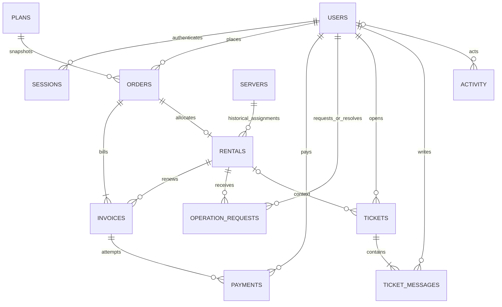

# VPS Rent database design

Team: Andrii Moroz, Artem Ankudinov, Illia Yerokhin.

The design is recorded before implementation. PostgreSQL is the only supported
database. Monetary amounts use integer euro cents. All timestamps use
`timestamptz` and UTC. Every table has a bigint primary key; foreign keys use
`ON DELETE RESTRICT`, except sessions, which cascade when a user is deleted.

| Entity | Attributes and constraints |
| --- | --- |
| users | id PK, email unique/not null/lowercase, password_hash, role CHECK customer/operator/support/manager, created_at |
| sessions | id PK, user_id FK, token_hash unique, csrf_token, expires_at |
| plans | id PK, name unique, description, cpu/ram_gb/disk_gb positive, monthly_cents/annual_cents positive, enabled, created_at |
| orders | id PK, customer_id FK users, plan_id FK plans, immutable plan_name/cpu/ram_gb/disk_gb/price_cents snapshots, term CHECK monthly/annual, status CHECK awaiting_payment/awaiting_allocation/active/expired, created_at |
| invoices | id PK, order_id FK, rental_id optional FK, kind CHECK initial/renewal, amount_cents positive, currency CHECK EUR, status CHECK unpaid/paid, created_at, paid_at optional; initial invoices have no rental, renewal invoices have a rental |
| payments | id PK, invoice_id FK, customer_id FK users, idempotency_key unique, outcome CHECK succeeded/failed, created_at; one successful payment per invoice |
| servers | id PK, name unique, address INET unique, cpu/ram_gb/disk_gb positive, ssh_user, password_ciphertext, state CHECK available/assigned/suspended/preparing, created_at |
| rentals | id PK, order_id unique FK, server_id FK, started_at, expires_at > started_at, status CHECK active/suspension_pending/suspended/ended, power CHECK running/stopped; at most one non-ended rental per server |
| operation_requests | id PK, rental_id FK, requested_by FK users, kind CHECK start/stop/restart, status CHECK pending/completed/rejected, result optional, resolved_by optional FK users, created_at, resolved_at optional; one pending operation per rental; completed/rejected requests require a resolver, result and resolution time |
| tickets | id PK, customer_id FK, rental_id optional FK, subject, status CHECK open/in_progress/closed, created_at |
| ticket_messages | id PK, ticket_id FK, author_id FK users, body, created_at |
| activity | id PK, actor_id optional FK users (NULL means system), action, entity_type, entity_id, result, created_at; append-only through application API |

All attributes are NOT NULL unless marked optional. No password or session token
is written to activity history. Server passwords are Fernet-encrypted with a
deployment key; account passwords are Argon2 hashes. Session tokens are random,
stored only as SHA-256 hashes in PostgreSQL and sent as HttpOnly cookies.

One role per account keeps staff privileges separate. Customers cannot provide
a role at registration. Plan edits never change an existing order or its renewal
price. An order's monthly renewal price is also snapshotted separately as
`renewal_cents`. Public plan visibility is controlled by `enabled`.

Indexes: all foreign keys used in lists; orders(customer_id, created_at),
orders(status, created_at), rentals(status, expires_at), tickets(status,
created_at), messages(ticket_id, created_at), activity(created_at), sessions
(expires_at), servers(state, cpu, ram_gb, disk_gb). Unique partial indexes:
rentals(server_id) WHERE status != ended, operation_requests(rental_id) WHERE
status = pending, payments(invoice_id) WHERE outcome = succeeded,
invoices(order_id) WHERE kind = initial, invoices(rental_id) WHERE kind =
renewal AND status = unpaid.

Allocation locks the order then server with SELECT FOR UPDATE and checks exact
resources. Payment locks the order then rental (renewals), then invoice. The
idempotency key belongs to one user, invoice and outcome; replaying it returns
the existing record. A failed payment does not change an invoice or rental.
Renewal locks the rental and refuses payment at/after expiration. A paid renewal
extends the existing expiry by exactly 30 days, once. The partial unique indexes
provide a second line of defense against concurrent requests.

Monthly allocation starts 30 days at assignment. The approved annual mockup adds
12 calendar months, clamping February 29 when needed. Subsequent renewals add
30 days. A periodic database-backed job marks expired rentals suspension_pending.
The operator confirms suspension, then preparation, before the server becomes
available. Start/stop/restart remain operator requests: the power state changes
only after successful completion. These are manual workflows, not a hypervisor
integration.
