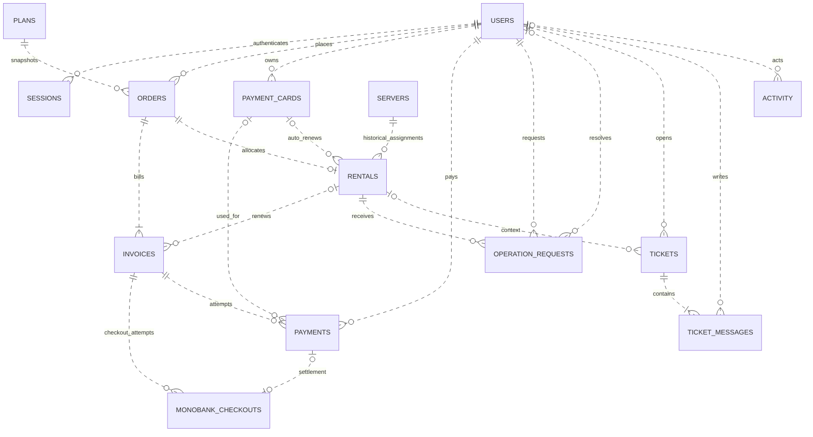

# VPS Rent database design

Team: Andrii Moroz, Artem Ankudinov, Illia Yerokhin.

The design is recorded before implementation. PostgreSQL is the only supported
database. Customer invoices use integer euro cents; bank charges snapshot integer UAH kopecks. All timestamps use
`timestamptz` and UTC. Every table has a bigint primary key; foreign keys use
`ON DELETE RESTRICT`, except sessions, which cascade when a user is deleted.

| Entity | Attributes and constraints |
| --- | --- |
| users | id PK, email unique/not null/lowercase, password_hash, role CHECK customer/operator/support/manager, created_at |
| sessions | id PK, user_id FK, token_hash unique, csrf_token, expires_at |
| plans | id PK, name unique, description, cpu/ram_gb/disk_gb positive, monthly_cents/annual_cents positive, enabled, created_at |
| orders | id PK, customer_id FK users, plan_id FK plans, immutable plan_name/cpu/ram_gb/disk_gb/price_cents/renewal_cents snapshots, term CHECK monthly/annual, status CHECK awaiting_payment/awaiting_allocation/active/expired, created_at |
| invoices | id PK, order_id FK, rental_id optional FK, kind CHECK initial/renewal, amount_cents positive, currency CHECK EUR, status CHECK unpaid/paid, created_at, paid_at optional; initial invoices have no rental, renewal invoices have a rental |
| payments | id PK, invoice_id FK, customer_id FK users, idempotency_key unique, status CHECK reserved/uncertain/pending/refund_pending/succeeded/failed/refunded, provider CHECK test/monobank, initiated_by CHECK customer/auto, provider_invoice_id optional unique, page_url optional, save_card, card_id optional FK, failure_reason optional, provider_modified_at optional, updated_at, reference optional unique, charge_amount/charge_currency optional paired positive quote, review_required, refund_reference optional unique, refund_started_at optional, created_at; one successful and one open attempt per invoice |
| payment_cards | id PK, customer_id FK users, encrypted token_ciphertext, token_hash, masked_pan, removed_at optional, created_at; active token_hash unique |
| monobank_checkouts | id PK, invoice_id FK, payment_id optional unique FK payments, reference unique, provider_invoice_id unique, payment_url, amount_kopecks/eur_uah_rate positive quote (both nullable for legacy EUR checkouts), status CHECK created/processing/hold/success/failure/expired/reversed, modified_at optional, expires_at, review_required, created_at; at most one pending checkout per invoice |
| servers | id PK, name unique, address INET unique, cpu/ram_gb/disk_gb positive, ssh_user, password_ciphertext, state CHECK available/assigned/suspended/preparing, created_at |
| rentals | id PK, order_id unique FK, server_id FK, started_at, expires_at > started_at, status CHECK active/suspension_pending/suspended/ended, power CHECK running/stopped, auto_renew_card_id optional FK payment_cards; at most one non-ended rental per server |
| operation_requests | id PK, rental_id FK, requested_by FK users, kind CHECK start/stop/restart, status CHECK pending/completed/rejected, result optional, resolved_by optional FK users, created_at, resolved_at optional; one pending operation per rental; completed/rejected requests require a resolver, result and resolution time |
| tickets | id PK, customer_id FK, rental_id optional FK, subject, status CHECK open/in_progress/closed, created_at |
| ticket_messages | id PK, ticket_id FK, author_id FK users, body, created_at |
| activity | id PK, actor_id optional FK users (NULL means system), action, entity_type, entity_id, result, created_at; append-only through application API |

All attributes are NOT NULL unless marked optional. No password or session token
is written to activity history. Server passwords are Fernet-encrypted with a
deployment key; account passwords are Argon2 hashes. Session tokens are random,
stored only as SHA-256 hashes in PostgreSQL and sent as HttpOnly cookies.

The complete diagram with all 127 attributes is available as
[editable Mermaid source](database.mmd). The overview below focuses on links.

All 22 relationships are non-identifying: no foreign key forms part of a
child table's primary key. Dashed lines express this independently of whether
the foreign key is nullable. The 14 application tables are shown; Alembic's
technical `alembic_version` table is omitted.

The `1..N` minimum for an order's invoices and a ticket's messages describes
an application invariant. The API creates the parent and its first child in
one transaction. PostgreSQL foreign keys alone do not enforce a minimum child
count; direct SQL could create a parent without children.

A server has `0..N` rentals over its history. The partial unique index limits
that history to at most one non-ended rental at a time. Similarly, an invoice
can have many payment attempts but only one successful payment. The unique
`rentals.order_id` means an order has at most one rental over its entire life.

Nullable relationships are conditional where appropriate: an initial invoice
has no rental, a renewal invoice requires one, and an operation has no resolver
until completed or rejected. A ticket may omit a rental, and a system activity
may omit its actor. `activity.entity_id` is a polymorphic reference selected
by `entity_type`, not an additional PostgreSQL foreign key.

Customer ownership, staff roles and consistency between an invoice's order
and rental are checked by the application. These rules are not implied by
the individual foreign keys. Snapshots and append-only activity history are
also protected through the application API rather than immutable SQL triggers.

New payment attempts are canonical `payments` rows. Their saved UAH amount and
currency are immutable charge quotes for the EUR invoice. Bank notifications
must match the saved bank invoice, reference and charge; rates are never
recomputed during settlement. Open attempts include reserved, uncertain,
pending and refund_pending states, all covered by a partial unique index.
Unknown automatic charges prevent a new debit. Processing refunds are not
reported as returned money.

`payment_cards` stores encrypted bank tokens, never raw card numbers or CVV.
The masked label is for display; token hashes identify duplicate active tokens.
Both cards and auto-renewal consent are customer-owned. Removed cards remain
historical rows while their renewal links are cleared.

`monobank_checkouts` is a retained historical ledger from the earlier Beta.
Its original EUR/UAH rates and charge quotes remain available for reconciliation.
The merge migration copies bank bindings into canonical payments, preserving
original payment IDs and rental expiry dates. New requests do not write this
legacy table. It can be retired only after historical reconciliation.

Indexes cover ownership lookups, chronological lists, availability matching,
expiry scans, queue state, pending payment reconciliation and card ownership.
Partial unique indexes enforce one held rental per VPS, one pending operation,
one initial invoice, one unpaid renewal invoice, one successful payment and
one open payment attempt per invoice. The exact constraints and indexes are
in [schema.sql](schema.sql) and checked against live PostgreSQL by
`python -m scripts.check_schema`.
