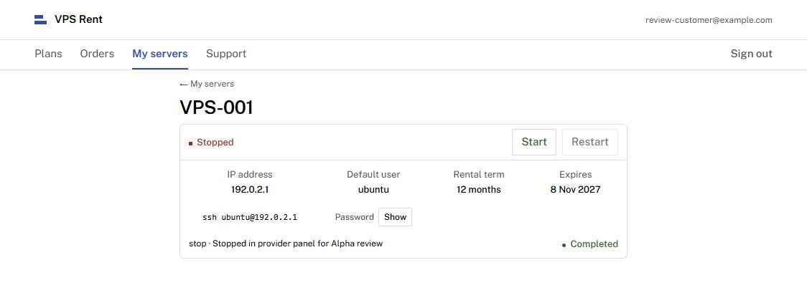

# Alpha verification — 2026-11-08

Environment: Windows, Python 3.13, PostgreSQL 17.11, SQLAlchemy 2.0 and FastAPI.

- 17 integration tests passed against a separate real PostgreSQL database.
- `ruff check` passed, including E/F import/style checks and the 79-character
  Python line limit. `ruff format --check` passed.
- `alembic check` reported no model/schema changes after the initial migration.
- `node --check app/static/app.js` passed.
- Browser review used the running FastAPI application on 127.0.0.1:8000.
  Registration, annual order, failed and successful test payment, queued server
  row, operator allocation, customer details, password Show/Hide, pending Stop
  and operator completion were exercised through the real UI.
- After operator completion, the customer panel displayed Start and disabled
  Restart. Payment and allocation survived logout/login and page reload.
- At a 390px viewport, document width and scroll width were both 390px; the
  server card fit within the viewport. The standard desktop viewport was restored.

The screenshot is an actual application view, not a generated image:

There is one non-failing dependency warning: the installed Starlette TestClient
reports that its httpx transport is deprecated in favor of httpx2. The pinned
transport works for the current 17-test suite; migration can be handled with a
future dependency update.
